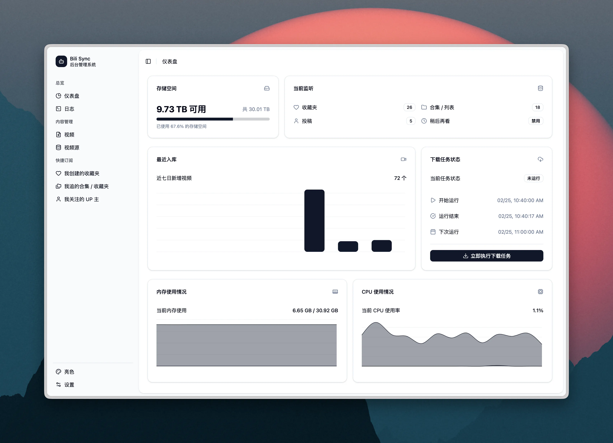
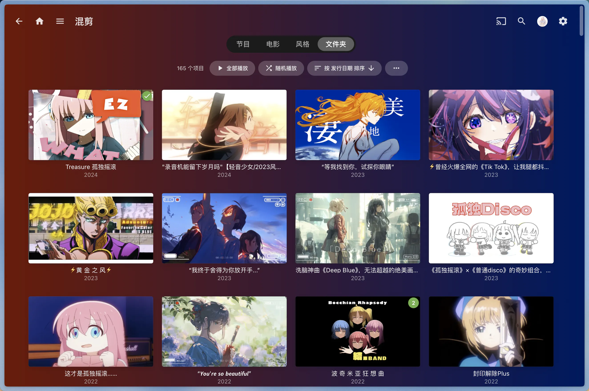
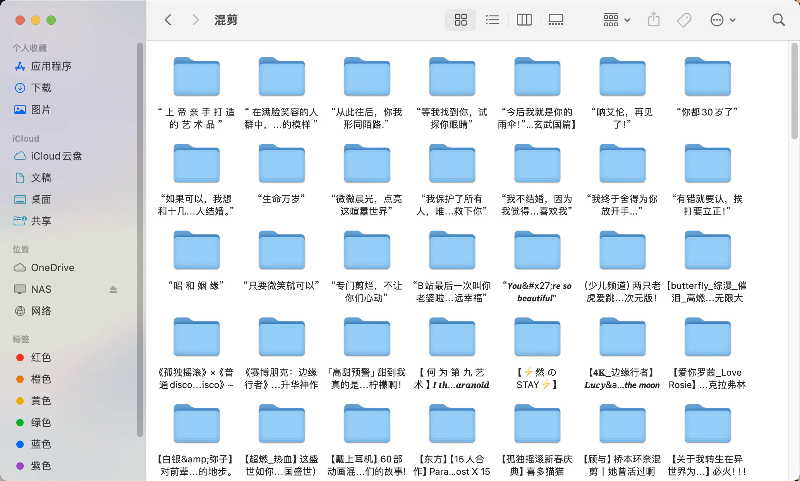

<div align="center">

# 🐳 bili-sync

**专为 NAS 打造的哔哩哔哩同步工具 · 由 Rust & Tokio 驱动 · 由 DeepSeek AI 维护与开发**

[](https://www.rust-lang.org/)
[](https://svelte.dev/)
[](./License)
[](https://github.com/BazzJiang/bili-sync)

[快速开始](#快速开始) · [文档](#文档) · [Releases](https://github.com/BazzJiang/bili-sync/releases) · [Issues](https://github.com/BazzJiang/bili-sync/issues) · [上游项目](https://github.com/amtoaer/bili-sync)

</div>

> [!IMPORTANT]
> **本项目参考并 fork 自 [amtoaer/bili-sync](https://github.com/amtoaer/bili-sync)，感谢原作者 amtoaer 的开源工作**——没有上游打下的基础，就没有这个项目。
>
> 本项目沿用 **MIT License**，上游的版权声明与许可文本完整保留（见 [License](./License)），上游的作者信息不会被抹去。
>
> 本项目由 **DeepSeek AI 驱动维护与开发**：代码、文档与构建流程主要由 AI 编写，维护者负责审核与验收。欢迎通过 [Issues](https://github.com/BazzJiang/bili-sync/issues) 提出需求、报告问题或吐槽体验。

---

## 你好，我是看板鲸鱼娘

> 我住在你的 NAS 里，每天安静地把喜欢的视频搬进本地媒体库。
> 听说 DeepSeek 帮我写代码之后，我的服务更稳、管理器也更好看了，所以我把水花喷得高高的，好让你一眼认出我。

```text
                      o    o     o
                       \   .    /
                        \  .   /
                         \ .  /
                      .-""""""""-.
             o       .'          '.
                    /              \      o
               o    |   o      o   |
                    | //        // |
             O      |      w       |        O
                    |              |
                o   \              /
                     '.          '.      o
              o       '--......--'
                      /          \
                      |  .-""-.  |
                      |  |bili|  |
                      |  '-..-'  |
                      \          /  .-.       .-.
                      '--......--' /   \     /   \
                                   \    \   /    /
                                    \    \_/    /
                                     \         /
                                   ~  '--.___.-'~
~~~  ~~~~~  ~~~  ~~~~  ~~~~  ~~~  ~~~~  ~~~~  ~~~  ~~~
```

> 💙 小彩蛋：在管理页按 `⌘K` / `Ctrl+K`（代码两种修饰键都监听）可以召唤命令面板，直接跳页面、跑任务、搜视频——这是本分支新做的；我衣服上印着 `bili`，但我只是第三方同步工具，和哔哩哔哩官方没有关系哦。

---

## 简介

bili-sync 是一款专为 NAS 用户编写的哔哩哔哩同步工具，由 Rust & Tokio 驱动。

它使用你填写的凭据定期扫描收藏夹、视频合集、UP 主投稿与「稍后再看」，把本地还没有的内容下载下来：视频、封面、弹幕、标签与简介信息一应俱全。文件布局遵循 Emby / Jellyfin 等媒体服务器支持的命名规范，目标文件夹可以直接作为媒体库导入，无需手工整理；整个程序只有一个可执行文件，SvelteKit 管理页在构建时被嵌入 Rust 二进制，运行时不依赖前端 Node 环境。

## 效果演示

### 管理页



> 截图为上游版本的仪表盘。本分支的管理页新增了「活动」「失败视频」页、`⌘K` 命令面板、批量操作等，详见[管理页文档](docs/frontend.md)。

### 媒体库与播放

| 概览 | 详情 |
| --- | --- |
|  |  |
| **播放（使用 infuse）** | **文件排布** |
|  |  |

## 这个分支做了什么

| 方向 | 本分支的变化 |
| --- | --- |
| 桌面托盘 | 新增 `desktop-tray/`：macOS 菜单栏 / Windows 通知区 / Linux SNI 常驻外壳，自动拉起并管理 `bili-sync-rs` |
| 管理页体验 | 新增「活动」「失败视频」页、`⌘K` 命令面板、视频批量操作、日志增强、设置页分区、仪表盘指标卡 |
| 构建与文档 | 补全 Windows（WSL2 + MinGW）交叉编译全流程、镜像与踩坑记录、增量构建与前端嵌入约定 |
| 细节修复 | 日志落盘前剥离子进程输出的 ANSI 颜色控制符；统一 LF 换行；中文提交信息模板 |

### 一、桌面托盘壳（desktop-tray）

它不是新的服务端，只是给已有的 `bili-sync-rs` 套一层常驻 UI，服务、数据库、下载任务全部仍由主程序负责。

| 平台 | 托盘后端 | 状态 |
| --- | --- | --- |
| macOS 11+ | NSStatusBar（template 图标，自动适配明暗） | 已验证（macOS arm64 端到端跑通拉起 / 接管 / 退出） |
| Windows 10/11 | Shell_NotifyIcon（不需要 WebView2，不是 Tauri） | 已完成交叉编译 + CLI 冒烟，**GUI 未真机验收** |
| Linux（X11 / Wayland） | StatusNotifierItem（纯 Rust 的 ksni 后端，无需 GTK/libappindicator） | 代码已适配，待实机回归 |

- 启动时自动拉起 `bili-sync-rs`，管理页就绪后打开浏览器；
- 托盘菜单提供「打开管理页 / 打开数据目录 / 打开日志 / 启动 / 停止 / 重启服务」；
- 单实例锁（flock）避免重复启动；若启动时管理页已经在跑，会判定为外部实例并「接管」，不会拉第二个进程，退出时也不会误杀；
- Unix 上用 `SIGTERM` 让主程序优雅退出；Windows 没有 `SIGTERM`，降级为 `TerminateProcess`（SQLite 是 WAL 模式，可恢复，但会丢当前下载进度）；
- 独立 workspace，不进入仓库根的 workspace，不影响 NAS 侧的 musl 发布构建；已写好三端构建工作流 [`desktop-tray.yaml`](.github/workflows/desktop-tray.yaml)（**尚未在 CI 实跑验证**），Windows 侧的交叉编译产物已提供（见下文「快速开始」）。

### 二、管理页 UX 改版

- **活动页**：下载任务状态、上次运行 / 下次运行时间、等待中队列与最近入库，每 15 秒自动刷新；
- **失败视频页**：集中列出所有失败视频，支持逐条 / 批量重置与「重置全部失败视频」；
- **`⌘K` 命令面板**：跳转页面、执行下载任务、搜索视频；
- **视频列表**：筛选面板 + 已生效条件 chips、自动刷新、批量勾选与批量「编辑状态 / 重置」；
- **日志页**：级别过滤、关键字搜索、暂停缓冲、清空与复制；
- **设置页**：按配置分区组织，左侧目录随滚动高亮，底部吸底保存条与「有未保存修改」提示；
- **仪表盘**：视频总数、失败视频、等待中、近七日新增四个指标卡。

> [!WARNING]
> 批量操作接口新增了可选的 `ids` 参数，**前后端必须同版本发布**。用旧后端搭配新前端时，批量操作可能退化为按筛选条件（甚至全部视频）执行。

### 三、构建与交叉编译文档

[`docs/build.md`](docs/build.md) 现在覆盖：前置依赖、构建顺序（必须先前端后 Rust）、增量构建与 `web/build` 嵌入机制、国内镜像配置、Windows（WSL2 + MinGW）交叉编译的完整命令、产物自包含检查（`objdump` 查 DLL）、WSL interop 下运行 Windows 产物的注意事项、与官方 CI（MSVC）的差异，以及一张踩坑记录表。仓库根的 [`AGENTS.md`](AGENTS.md) 则记录了面向 AI agent 的构建与代码约定。

## 功能与路线图

- [x] 使用用户填写的凭据认证，并在必要时自动刷新
- [x] 支持收藏夹与视频列表 / 视频合集的下载
- [x] 自动选择用户设置范围内最优的视频和音频流，并在下载完成后使用 FFmpeg 合并
- [x] 使用 Tokio 与 Reqwest，对视频、视频分页进行异步并发下载
- [x] 使用媒体服务器支持的文件命名，方便一键作为媒体库导入
- [x] 当前轮次下载失败会在下一轮下载时重试，失败次数过多自动丢弃
- [x] 使用数据库保存媒体信息，避免对同个视频的多次请求
- [x] 打印日志，并在请求出现风控时自动终止，等待下一轮执行
- [x] 提供多平台的二进制可执行文件，为 Linux 平台提供了立即可用的 Docker 镜像
- [x] 支持对「稍后再看」内视频的自动扫描与下载
- [x] 支持对 UP 主投稿视频的自动扫描与下载
- [x] 支持限制任务的并行度和接口请求频率
- [x] 支持单个文件的分块并行下载
- [x] 支持使用 Web UI 配置，查看并管理视频、视频源
- [x] 桌面托盘外壳、管理页活动 / 失败视频页、`⌘K` 命令面板、批量操作与日志增强

## 快速开始

> 三种方式任选其一。无论哪种，运行前都需要 **FFmpeg**（命令行能直接执行 `ffmpeg -version`），否则程序启动即退出。

### 方式一：下载预编译产物（目前为桌面托盘发行包）

> 本仓库的 Release 目前只有两个桌面托盘发行包：Windows x86_64 与 macOS Apple Silicon。Linux、macOS Intel 等平台暂无预编译产物。

1. Windows x86_64：下载 `bili-sync-tray-windows-x86_64.zip`，内含 `bili-sync-tray.exe`、`bili-sync-rs.exe` 与 `README.txt`；**两个 exe 必须放在同一目录**，托盘会在同目录查找主程序。产物未签名，首次运行可能被 SmartScreen 拦下，按「更多信息 → 仍要运行」放行。
2. macOS Apple Silicon：下载 `bili-sync-tray-macos-aarch64.tar.gz`，包内是 `bili-sync-tray.app`、同名命令行程序 `bili-sync-tray`、`bili-sync-rs` 与说明文件（均未签名，首次打开 `.app` 可能需在「系统设置 → 隐私与安全性」中放行）。
3. 确认 **FFmpeg** 已在 PATH 中（`ffmpeg -version` 可执行），否则主程序启动即退出。
4. 首次启动日志会打印一次 `auth_token`，打开 `http://127.0.0.1:12345/`，在设置页填入即可完成认证。
5. 下载地址：<https://github.com/BazzJiang/bili-sync/releases>；需要 Linux、macOS Intel 或纯命令行主程序时，请用下面的 Docker 或源码构建方式。

### 方式二：Docker 部署

Linux/amd64 与 Linux/arm64 可以直接用 Docker Compose 部署，以下是最小示例（完整注释版见[快速开始文档](docs/quick-start.md)）：

```yaml
services:
  bili-sync-rs:
    image: amtoaer/bili-sync-rs:v2.11.1   # 按需替换为最新 tag，不建议长期用 latest
    restart: unless-stopped
    tty: true
    user: 1000:1000
    ports:
      - "12345:12345"
    volumes:
      - ./bili-sync-config:/app/.config/bili-sync
      # UP 主头像目录，需与程序里填写的位置一致才能在 Emby/Jellyfin 中显示
      - ./metadata/people:/app/.config/bili-sync/upper_face
      # 视频保存目录：容器内路径 /data/videos 需与管理页填写的下载路径一致
      - ./Videos:/data/videos
```

保存为 `docker-compose.yml` 后执行 `docker compose up -d`，浏览器打开 `http://<宿主机>:12345/`。

> [!NOTE]
> 该镜像由上游发布，**不包含本分支的管理页改动**；本 fork 目前也没有发布独立镜像。想用本分支的管理页，请使用源码构建，或在本地执行 `just build-docker` 自行打镜像（需要 musl 交叉编译工具链）。

### 方式三：从源码构建

前置依赖：Rust 1.98.0（由 `rust-toolchain.toml` 固定）、Bun、C 工具链（clang 或 gcc）、Git，以及运行期需要的 FFmpeg。

```bash
# 1. 先构建前端，产物输出到 web/build
cd web && bun install --frozen-lockfile && bun run build && cd ..

# 2. 再编译后端，产物为 target/release/bili-sync-rs
cargo build --release
```

> [!IMPORTANT]
> 顺序不能反：`rust-embed-for-web` 会在编译期读取 `web/build`，跳过前端会让二进制里没有管理页面（访问 404）。
> Windows 交叉编译（WSL2 + MinGW）、镜像加速与踩坑记录见 [`docs/build.md`](docs/build.md)。

### 桌面托盘怎么用

一句话：**把 `bili-sync-tray` 和 `bili-sync-rs` 放在同一目录，运行托盘即可**，它会自动拉起服务、等服务就绪后打开管理页。

```bash
# 最常见：与 bili-sync-rs 同目录，直接运行
./bili-sync-tray
# 指定主程序 / 配置目录 / 端口
./bili-sync-tray --bin /path/to/bili-sync-rs --config-dir /data/bili-sync --port 12345
# 冒烟：只探测管理页是否活着（0 = 运行中，1 = 未运行）
./bili-sync-tray --check --port 12345
```

完整参数、进程生命周期与日志位置见 [`desktop-tray/README.md`](desktop-tray/README.md)。

## 已知限制

1. **Windows 托盘只完成了交叉编译与 CLI 冒烟**（`--version`、`--check` 通过），托盘图标与菜单的 GUI 交互**尚未在真实 Windows 上验收**，可能存在问题，欢迎反馈。
2. **macOS / Windows 产物未做代码签名**：Windows 首次运行可能被 SmartScreen 拦下（「更多信息」→「仍要运行」），macOS 可能被 Gatekeeper 要求手动放行。
3. **Windows 停止服务是 `TerminateProcess` 兜底**：WAL 模式可恢复数据库，但当前下载进度会丢失；更理想的做法是上游提供带 token 的 HTTP 停止接口。
4. **Linux 托盘图标依赖桌面环境的 SNI host**：KDE / Xfce / Cinnamon / MATE 一般自带，GNOME 需要安装 AppIndicator 扩展；没有 SNI host 时服务仍会正常运行，只是没有图标可点。
5. **托盘没有自动更新、也不写开机自启项**（升级靠替换二进制）；**视频列表一次性加载全部**，数据量很大时浏览器渲染会变慢。
6. **前后端存在接口契约**：批量操作新增的 `ids` 参数要求前后端同版本发布，混用会退化行为。
7. **本 fork 未发布独立 Docker 镜像**，Docker 方式使用的是上游镜像。
8. **release 构建的前端响应要求客户端支持 gzip / br**，用 `curl` 调试时需要加 `--compressed`，否则会拿到 406。

## 文档

中文文档位于仓库 [`docs/`](docs/)，主要章节：

| 文档 | 内容 |
| --- | --- |
| [快速开始](docs/quick-start.md) | 三种部署方式、首次配置、添加视频源 |
| [配置说明](docs/configuration.md) | 每一项配置的含义与取值 |
| [命令行参数](docs/args.md) | 启动参数列表 |
| [工作原理](docs/design.md) | 扫描、下载、写入媒体库的流程 |
| [管理页](docs/frontend.md) | 管理页各页面的功能说明 |
| [从源码构建](docs/build.md) | 构建、增量编译、镜像与交叉编译 |
| [常见问题](docs/question.md) | 挂载、权限等高频问题 |

> 在线文档沿用上游站点：<https://bili-sync.amto.cc/>（由上游维护，内容目前与上游一致）。本分支新增的目录与章节以仓库内 `docs/` 为准。

## 参考与借鉴

本项目的实现离不开以下开源项目，感谢它们作者的贡献：

- [bilibili-API-collect](https://github.com/SocialSisterYi/bilibili-API-collect)：B 站的第三方接口文档
- [bilibili-api](https://github.com/Nemo2011/bilibili-api)：使用 Python 调用接口的参考实现
- [danmu2ass](https://github.com/gwy15/danmu2ass)：本项目弹幕下载功能的缝合来源

## 致谢与许可

- 上游项目：[amtoaer/bili-sync](https://github.com/amtoaer/bili-sync)，原作者 **amtoaer**，感谢其长期维护与开源。
- 本项目基于上游代码继续开发，遵循 **MIT License**，原始版权声明见 [License](./License)；本分支的修改同样以 MIT 发布，欢迎 fork、提 PR、开 Issue。
- 关于「AI 驱动开发」：代码与文档主要由 DeepSeek AI 编写、维护者审核验收；AI 也会犯错，发现问题请直接开 [Issue](https://github.com/BazzJiang/bili-sync/issues)。

## 免责声明

本项目仅供**个人学习、技术研究与本地备份**使用。请遵守哔哩哔哩的用户协议与服务条款，不要将本项目用于商业用途、批量分发下载内容或任何侵犯版权与他人权益的行为。下载内容的版权归原作者与平台所有，请勿二次传播。使用本项目产生的一切后果由使用者自行承担。
