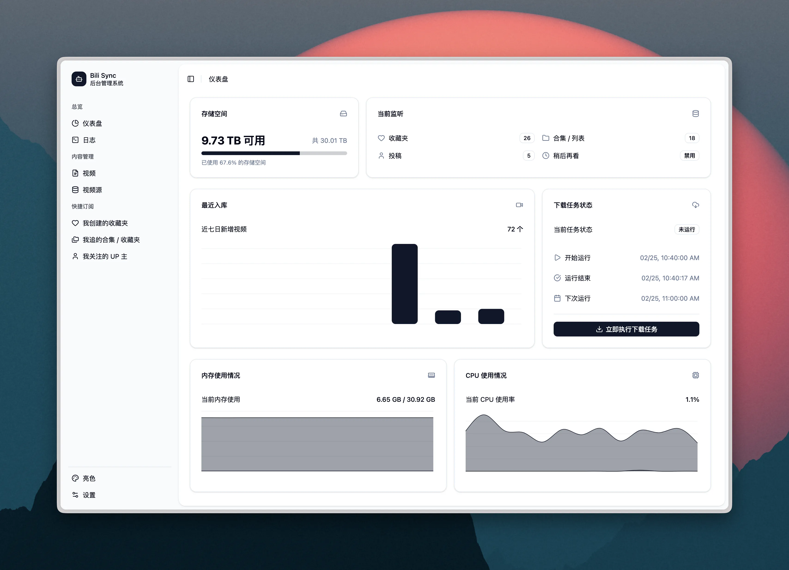

# 管理页

自 2.6.0 版本开始，bili-sync 的配置文件已经完全迁移至数据库中，程序的所有操作都可以通过 WebUI 管理页进行。

管理页是一个单页应用（SvelteKit），随二进制一起分发，默认监听 `0.0.0.0:12345`。首次启动时日志会打印一次 `auth_token`，在设置页填入后即可使用；token 存放在配置目录的 `data.sqlite` 的 `config` 表中，可在设置页的「接口认证」处查看和修改。

## 导航结构

| 分组 | 页面 | 用途 |
| --- | --- | --- |
| 总览 | 仪表盘 | 关键指标、存储/内存、任务状态、最近入库 |
| 总览 | 活动 | 下载任务的运行状态、等待中与最近入库 |
| 总览 | 日志 | 实时日志（WebSocket），支持过滤与暂停 |
| 内容管理 | 视频 | 已入库视频列表，筛选、批量操作、单条重置 |
| 内容管理 | 失败视频 | 所有下载失败的视频，集中重试 |
| 内容管理 | 视频源 | 收藏夹 / 合集 / UP 主投稿 / 稍后再看的管理 |
| 快捷订阅 | —— | 从 B 站账号读取的收藏夹、合集、UP 主，一键订阅 |
| —— | 设置 | 全部配置项（分区导航 + 吸底保存） |

右上角的「搜索 ⌘K」（macOS 为 `⌘K`，其它系统为 `Ctrl+K`）可以随时打开命令面板，直接跳转页面、执行下载任务或搜索视频。

## 仪表盘

顶部四个关键指标卡：**视频总数、失败视频、等待中、近七日新增**。失败视频与等待中可直接点击跳转到对应列表，其它卡片（存储空间、当前监听、最近入库、下载任务状态、内存/CPU）保持原有能力。

## 活动

- 「下载任务」卡片实时显示任务状态、上次运行 / 上次完成 / 下次运行时间，并可手动「立即执行」
- 「等待中」展示排队中的视频（最多 10 条，可跳转完整列表）
- 「最近入库」展示最近入库的视频
- 页面每 15 秒自动刷新一次，可关闭；页面切到后台时暂停刷新

## 视频列表

- **筛选**：搜索框 + 「筛选」按钮展开筛选面板（创建时间 / 有效性 / 状态 / 来源），已生效的条件以标签（chips）形式展示，可单独移除或一键清除；筛选条件会写入 URL，可直接分享或前进后退
- **自动刷新**：默认开启，任务开始/结束时立即刷新，另每 30 秒兜底轮询；可手动关闭，也可随时点右侧按钮手动刷新
- **批量操作**：勾选行（或表头全选）后出现批量操作条，支持批量「编辑状态」「重置」，与筛选条件互不影响
- **单行操作**：详情、重置、清空重置、在 B 站打开；进度条悬停可查看 5 个子任务的完成情况
- 列表为一次性加载全部（不分页），数据量很大时浏览器渲染会变慢

## 失败视频

集中展示所有下载失败的视频，支持逐条重置/清空重置，也可以「重置全部失败视频」（可勾选强制重置）。失败原因仍需到日志页查看。

## 视频源

按收藏夹 / 合集 / UP 主投稿 / 稍后再看分页展示，列表中可直接编辑、重新评估规则、全量同步、删除和查看启用状态。

## 日志

- 按级别过滤（全部 / INFO / WARN / ERROR）、关键字搜索
- 「暂停」后新日志会缓冲，恢复时补齐；支持清空和复制当前过滤结果
- 保留最近 500 条，默认自动滚动到最新位置（手动上滚后暂停自动滚动）

## 设置

- 左侧为配置目录，点击跳转、滚动时自动高亮；移动端为顶部横向标签
- 底部悬浮保存条：显示「有未保存的修改 / 已保存」，保存入口唯一
- 所有原有配置项（绑定地址、B 站认证、视频过滤、弹幕、NFO、通知器、下载并发等）均保留，除绑定地址外基本实时生效
